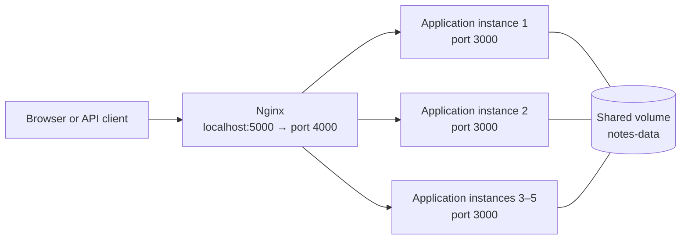

# digi-tech-one

A small notes web application. Users can add notes through a web form or an HTTP API. The application runs in multiple containers, Nginx distributes requests between them, and notes are stored in a shared Docker volume.

## Build and publish to Docker Hub

Replace `YOUR_DOCKERHUB_USERNAME` with your Docker Hub username. Sign in, build the image from the project root, and push it to Docker Hub:

```powershell
docker login -u YOUR_DOCKERHUB_USERNAME
docker build -t YOUR_DOCKERHUB_USERNAME/digi-tech-one:1.0 .
docker push YOUR_DOCKERHUB_USERNAME/digi-tech-one:1.0
```

To run your published image with Compose, update the `image` value for the `digi-tech-one` service in `compose\docker-compose.yml`:

```yaml
image: "YOUR_DOCKERHUB_USERNAME/digi-tech-one:1.0"
```

## Automatic startup with Docker Compose

You need Docker Desktop with the Linux Engine running and Docker Compose. Run all commands below from the project root in PowerShell.

```powershell
docker compose -p digi-tech-one -f compose\docker-compose.yml up -d --scale digi-tech-one=5
```

Compose starts five instances of the `digi-tech-one` application and one Nginx container. Each application listens on port `3000` inside the Docker network. Nginx accepts external requests on port `5000` and forwards them to the application service.

Open [http://localhost:5000](http://localhost:5000). To see which instance handled a request, open `http://localhost:5000/api/whoami`.

Check the running containers:

```powershell
docker compose -p digi-tech-one -f compose\docker-compose.yml ps
```

You should see five `digi-tech-one` containers and one `nginx` container.

## Manual Docker startup

Use either Compose or the manual setup at a time. If Compose is running, stop it first to free port `5000`:

```powershell
docker compose -p digi-tech-one -f compose\docker-compose.yml down
```

To start multiple application containers manually, create a Docker network and a shared volume:

```powershell
docker network create digi-tech-one
docker volume create notes-data
```

Run the same image five times. The network alias lets Nginx reach the application instances by the service name used in `nginx.conf`:

```powershell
$image = "xmyronenkoo/oleksandr_myronenko:1.0"

docker run -d --name digi-tech-one-1 --network digi-tech-one --network-alias digi-tech-one -v notes-data:/data $image
docker run -d --name digi-tech-one-2 --network digi-tech-one --network-alias digi-tech-one -v notes-data:/data $image
docker run -d --name digi-tech-one-3 --network digi-tech-one --network-alias digi-tech-one -v notes-data:/data $image
docker run -d --name digi-tech-one-4 --network digi-tech-one --network-alias digi-tech-one -v notes-data:/data $image
docker run -d --name digi-tech-one-5 --network digi-tech-one --network-alias digi-tech-one -v notes-data:/data $image
```

Start Nginx on the same network, using the project configuration. Run this command from the project root:

```powershell
docker run -d --name nginx --network digi-tech-one -p 5000:4000 `
  -v "${PWD}\compose\nginx.conf:/etc/nginx/nginx.conf:ro" nginx:latest
```

Open [http://localhost:5000](http://localhost:5000). To stop the manually started containers and remove the network while preserving notes:

```powershell
docker rm -f nginx digi-tech-one-1 digi-tech-one-2 digi-tech-one-3 digi-tech-one-4 digi-tech-one-5
docker network rm digi-tech-one
```

The `notes-data` volume remains. Remove it only when you also want to permanently delete the saved notes:

```powershell
docker volume rm notes-data
```

## Usage

- On the home page, enter a note and click **Add**.
- `GET http://localhost:5000/api/notes` returns the list of notes as JSON.
- `POST http://localhost:5000/api/notes` adds a note. PowerShell example:

  ```powershell
  Invoke-RestMethod -Method Post `
    -Uri http://localhost:5000/api/notes `
    -ContentType 'application/json' `
    -Body '{"text":"Example note"}'
  ```

- `GET http://localhost:5000/api/whoami` returns the name of the container that handled the request.

## Architecture



## Stop

Stop and remove the containers and network while **preserving notes**:

```powershell
docker compose -p digi-tech-one -f compose\docker-compose.yml down
```

To also remove the volume containing the notes:

```powershell
docker compose -p digi-tech-one -f compose\docker-compose.yml down -v
```

> `down -v` permanently deletes the saved notes.
