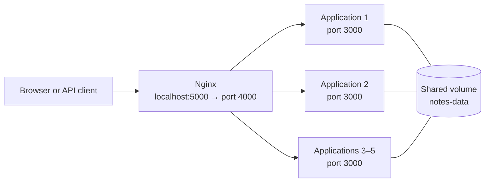

# digi-tech-one

A small notes web application. Users can add notes through a web form or an HTTP API. The application runs in multiple containers, Nginx distributes requests between them, and notes are stored in a shared Docker volume.

## Build and publish to Docker Hub

Replace `YOUR_DOCKERHUB_USERNAME` with your Docker Hub username. Sign in, build the image from the project root, and push it to Docker Hub:

```powershell
docker login -u YOUR_DOCKERHUB_USERNAME
docker build -t YOUR_DOCKERHUB_USERNAME/digi-tech-one:1.0 .
docker push YOUR_DOCKERHUB_USERNAME/digi-tech-one:1.0
```

To run your published image with Compose, update the `image` value for the `digi-tech-one` service in `compose\docker-compose.yml`:

```yaml
image: "YOUR_DOCKERHUB_USERNAME/digi-tech-one:1.0"
```

## Quick start

You need Docker Desktop with the Linux Engine running and Docker Compose. Run all commands below from the project root in PowerShell.

```powershell
docker compose -p digi-tech-one -f compose\docker-compose.yml up -d --scale digi-tech-one=5
```

Open [http://localhost:5000](http://localhost:5000). To see which instance handled a request, refresh the page or open `http://localhost:5000/api/whoami`.

Check the running containers:

```powershell
docker compose -p digi-tech-one -f compose\docker-compose.yml ps
```

You should see five `digi-tech-one` containers and one `nginx` container.

## Usage

- On the home page, enter a note and click **Add**.
- `GET http://localhost:5000/api/notes` returns the list of notes as JSON.
- `POST http://localhost:5000/api/notes` adds a note. PowerShell example:

  ```powershell
  Invoke-RestMethod -Method Post `
    -Uri http://localhost:5000/api/notes `
    -ContentType 'application/json' `
    -Body '{"text":"Example note"}'
  ```

- `GET http://localhost:5000/api/whoami` returns the name of the container that handled the request.

## Architecture



## Stop

Stop and remove the containers and network while **preserving notes**:

```powershell
docker compose -p digi-tech-one -f compose\docker-compose.yml down
```

To also remove the volume containing the notes:

```powershell
docker compose -p digi-tech-one -f compose\docker-compose.yml down -v
```

> `down -v` permanently deletes the saved notes.
