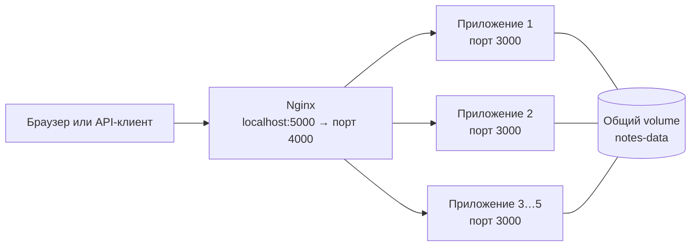

# digi-tech-one

Небольшое веб-приложение для заметок: пользователь добавляет записи через веб-форму или HTTP API. Приложение запускается в нескольких контейнерах, Nginx распределяет между ними запросы, а заметки хранятся в общем Docker volume.

## Быстрый запуск

Нужны Docker Desktop с запущенным Linux Engine и Docker Compose. Все команды ниже выполняются из корня проекта в PowerShell.

```powershell
docker compose -p digi-tech-one -f compose\docker-compose.yml up -d --scale digi-tech-one=5
```

Откройте [http://localhost:5000](http://localhost:5000). Чтобы увидеть, какой экземпляр ответил на запрос, обновите страницу или откройте `http://localhost:5000/api/whoami`.

Проверить запущенные контейнеры:

```powershell
docker compose -p digi-tech-one -f compose\docker-compose.yml ps
```

Ожидаются пять контейнеров `digi-tech-one` и один контейнер `nginx`.

## Как пользоваться

- На главной странице введите заметку и нажмите **Pridať**.
- `GET http://localhost:5000/api/notes` возвращает список заметок в JSON.
- `POST http://localhost:5000/api/notes` добавляет заметку. Пример в PowerShell:

  ```powershell
  Invoke-RestMethod -Method Post `
    -Uri http://localhost:5000/api/notes `
    -ContentType 'application/json' `
    -Body '{"text":"Пример заметки"}'
  ```

- `GET http://localhost:5000/api/whoami` возвращает имя ответившего контейнера.

## Схема



## Остановка

Остановить и удалить контейнеры и сеть, **сохранив заметки**:

```powershell
docker compose -p digi-tech-one -f compose\docker-compose.yml down
```

Удалить также volume с заметками:

```powershell
docker compose -p digi-tech-one -f compose\docker-compose.yml down -v
```

> `down -v` безвозвратно удаляет сохранённые заметки.
