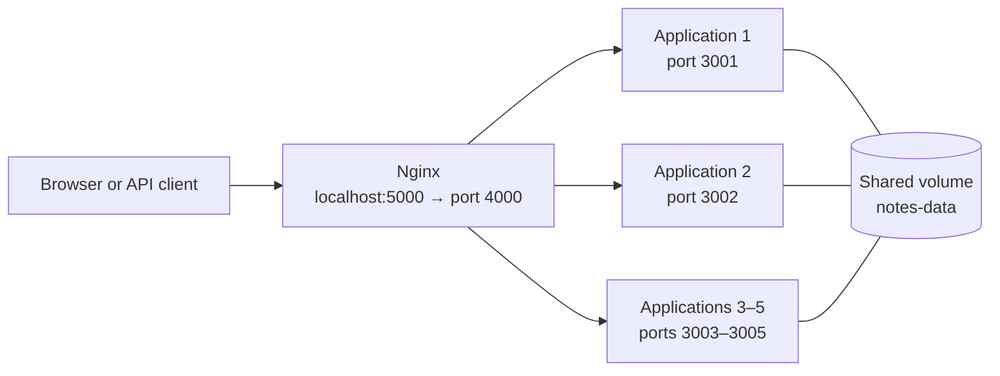

# digi-tech-one

A small notes web application. Users can add notes through a web form or an HTTP API. The application runs in multiple containers, Nginx distributes requests between them, and notes are stored in a shared Docker volume.

## Build and publish to Docker Hub

Replace `YOUR_DOCKERHUB_USERNAME` with your Docker Hub username. Sign in, build the image from the project root, and push it to Docker Hub:

```powershell
docker login -u YOUR_DOCKERHUB_USERNAME
docker build -t YOUR_DOCKERHUB_USERNAME/digi-tech-one:1.0 .
docker push YOUR_DOCKERHUB_USERNAME/digi-tech-one:1.0
```

To run your published image with Compose, update the `image` value for the `digi-tech-one` service in `compose\docker-compose.yml`:

```yaml
image: "YOUR_DOCKERHUB_USERNAME/digi-tech-one:1.0"
```

## Automatic startup with Docker Compose

You need Docker Desktop with the Linux Engine running and Docker Compose. Run all commands below from the project root in PowerShell.

```powershell
docker compose -p digi-tech-one -f compose\docker-compose.yml up -d
```

Compose starts five application containers, listening on ports `3001` through `3005`, and Nginx. Nginx accepts requests on port `5000` and distributes them across the five application ports in round-robin order.

Open [http://localhost:5000](http://localhost:5000). To see which instance handled a request, refresh the page or open `http://localhost:5000/api/whoami`. You can also access each application directly at `http://localhost:3001` through `http://localhost:3005`.

Check the running containers:

```powershell
docker compose -p digi-tech-one -f compose\docker-compose.yml ps
```

You should see five `app-*` containers and one `nginx` container.

## Manual Docker startup

The same setup can be started without Compose. Run these commands from the project root in PowerShell. The example uses the published image configured in `compose\docker-compose.yml`.

Use either the Compose setup or the manual setup at a time. If Compose is running, stop it first to release ports `3001`–`3005` and `5000`:

```powershell
docker compose -p digi-tech-one -f compose\docker-compose.yml down
```

Create a shared Docker network and volume:

```powershell
docker network create digi-tech-one
docker volume create notes-data
```

Start five application containers. Each listens on its own port; the shared volume keeps their notes together:

```powershell
$image = "xmyronenkoo/oleksandr_myronenko:1.0"

docker run -d --name app-1 --network digi-tech-one -p 3001:3001 -e PORT=3001 -v notes-data:/data $image
docker run -d --name app-2 --network digi-tech-one -p 3002:3002 -e PORT=3002 -v notes-data:/data $image
docker run -d --name app-3 --network digi-tech-one -p 3003:3003 -e PORT=3003 -v notes-data:/data $image
docker run -d --name app-4 --network digi-tech-one -p 3004:3004 -e PORT=3004 -v notes-data:/data $image
docker run -d --name app-5 --network digi-tech-one -p 3005:3005 -e PORT=3005 -v notes-data:/data $image
```

Start Nginx on the same network, using the project configuration:

```powershell
docker run -d --name nginx --network digi-tech-one -p 5000:4000 `
  -v "${PWD}\compose\nginx.conf:/etc/nginx/nginx.conf:ro" nginx:latest
```

Open [http://localhost:5000](http://localhost:5000). Nginx distributes requests among the applications. To stop the manually started containers and remove the network while preserving notes:

```powershell
docker rm -f nginx app-1 app-2 app-3 app-4 app-5
docker network rm digi-tech-one
```

The `notes-data` volume remains. Remove it only when you also want to permanently delete the saved notes:

```powershell
docker volume rm notes-data
```

## Usage

- On the home page, enter a note and click **Add**.
- `GET http://localhost:5000/api/notes` returns the list of notes as JSON.
- `POST http://localhost:5000/api/notes` adds a note. PowerShell example:

  ```powershell
  Invoke-RestMethod -Method Post `
    -Uri http://localhost:5000/api/notes `
    -ContentType 'application/json' `
    -Body '{"text":"Example note"}'
  ```

- `GET http://localhost:5000/api/whoami` returns the name of the container that handled the request.

## Architecture



## Stop

Stop and remove the containers and network while **preserving notes**:

```powershell
docker compose -p digi-tech-one -f compose\docker-compose.yml down
```

To also remove the volume containing the notes:

```powershell
docker compose -p digi-tech-one -f compose\docker-compose.yml down -v
```

> `down -v` permanently deletes the saved notes.
